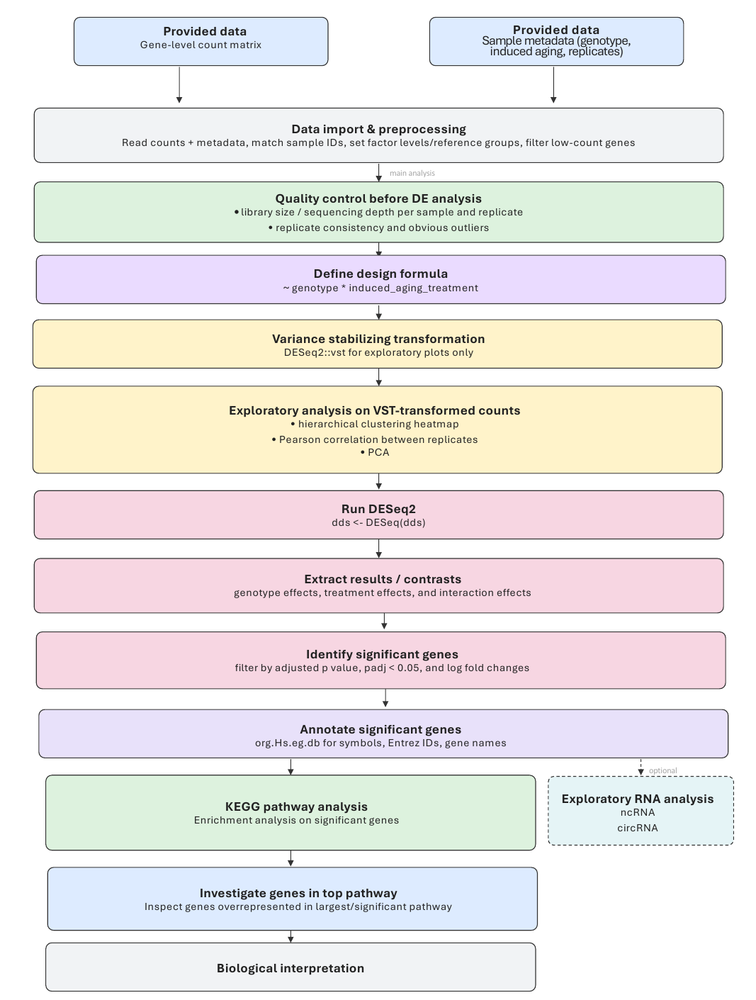

# APOE RNA-seq Data Challenge

[Read the original challenge report (PDF)](report/data_challenge_HMC.pdf)

## Introduction

**How do APOE genotype and induced ageing affect the transcriptional state of human brain organoids, and does the response to treatment differ between the two APOE lines?**

### Provided data

- `counts.tsv` contains gene-level counts generated from STAR-aligned BAM files using GENCODE v49 annotation.
- `RNAseq_challenge_metadata.csv` records the APOE genotype, treatment duration, harvest day, and biological replicate for each sample.
- `multiqc_report.html` summarizes sequencing and alignment quality.

### Experimental design

The APOE4 line is the parental donor line. The APOE3 line is a CRISPR-edited isogenic line from the same donor. Each genotype-by-treatment group has three separate biological replicates of its respective line. Ageing was induced by inhibiting neddylation for 10 or 20 days. [Saurat et al., 2024](https://doi.org/10.1016/j.stem.2024.06.001)

### Harvest-day confounding

The 10-day treatment group was harvested on day 70. Untreated controls and 20-day-treated organoids were both harvested on day 80. Comparisons involving the 10-day arm and either of the other arms therefore combine treatment and harvest-day differences. The primary analysis compares 20 days of treatment with untreated controls at the matched day-80 harvest.

### Software

The analysis uses R 4.3.2, DESeq2 for differential expression, and KEGG for pathway enrichment. Package versions are documented in the report and its session information.

## Analysis workflow

The diagram shows the original submission workflow.



[Download the workflow PDF](assets/workflow.pdf)

### What the revision added

- A MultiQC summary and rationale for retaining all 18 libraries, including the different roles of STAR genomic alignment and Salmon transcriptome quantification.
- A [replicate-level ncRNA figure](figures/ncrna-replicate-responses.png) generated in the revised DESeq2 report. It shows the day-80 responses for PKN2-AS1, MIR124-2HG and DUBR using expression values from all three replicates per group.
- A discussion of the day-70 harvest confounding, the single-donor design, and the limits of interpreting bulk expression and RNA annotations.

See the [figure index](figures/README.md) for the PCA, sample-distance heatmap, volcano plots, and KEGG enrichment panels.

## Next steps

A separate exploratory edgeR analysis tested sample-inclusion sensitivity, ran complementary GO enrichment, and compared circRNA host annotations against an expression-adjusted background. Those checks sit outside the DESeq2 workflow in this repository.

- **Check robustness within DESeq2.** Refit using only the day-80 libraries and check how much individual libraries influence the interaction. Obtain processing and sequencing batch details to investigate the shared STAR mapping pattern in APOE4 at day 20.
- **Extend pathway and circRNA host analyses within DESeq2.** Compare directional KEGG enrichment with a complementary gene-set test. Compare circRNA host discoveries against the tested background while accounting for expression and, where possible, gene length and transcript complexity.
- **Resolve individual RNA isoforms.** Obtain transcript-level quantifications for isoform expression or usage, and original sequencing reads for back-splice junction analysis of circular RNA.
- **Check generalizability.** Repeat the matched-harvest experiment in additional donors and independently edited lines.

## Run locally

1. The three challenge inputs and the circAtlas annotation are included in [data/](data/README.md).
2. Use R 4.3 with Bioconductor packages DESeq2, apeglm, AnnotationDbi, org.Hs.eg.db, clusterProfiler, edgeR and genefilter. The report also uses rmarkdown, knitr, ggplot2, dplyr, pheatmap, RColorBrewer, ashr, ggrepel, patchwork and xml2.
3. From the repository root, run:

   ```sh
   Rscript -e 'rmarkdown::render("analysis.Rmd", output_format = "html_document", output_dir = "output")'
   ```

Rendering requires Pandoc. A full render queries the KEGG API. For an offline version with the original pathway narrative and the newly computed non-KEGG sections, use:

```sh
Rscript -e 'rmarkdown::render("analysis.Rmd", output_format = "html_document", output_dir = "output", params = list(run_kegg = FALSE))'
```

To extract the executable code for inspection, run `knitr::purl("analysis.Rmd")` in R. The R Markdown is the executable source of the report. For PDF, use `output_format = "pdf_document"` with a LaTeX installation. The source report is [analysis.Rmd](analysis.Rmd). Newly rendered reports are saved locally in `output/`.
